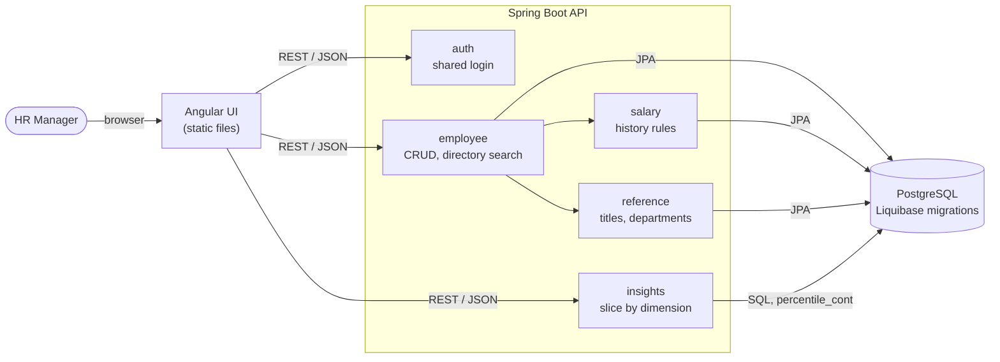
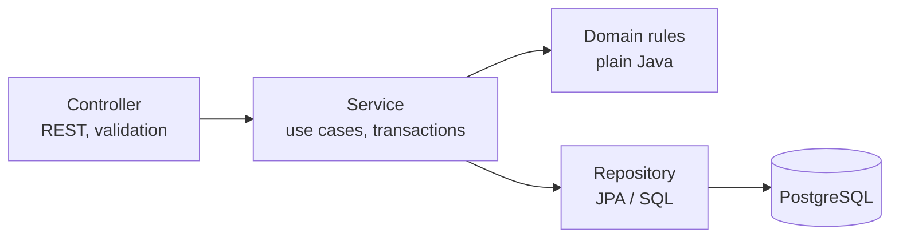
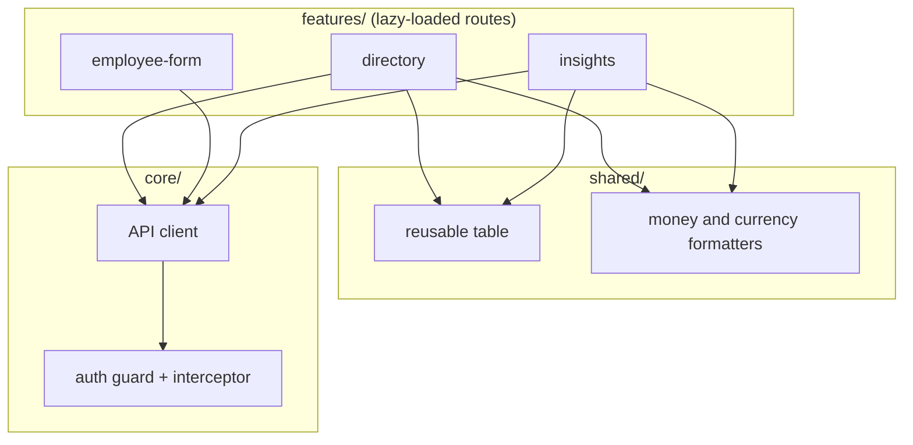
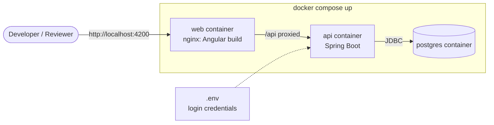

# Architecture [WIP]

High-level view of ACME People Management. See [design.md](../design.md) for the reasoning behind each choice.

## 1. System overview

The Angular UI is a separate app from the API. The API is a Spring Boot app that talks to PostgreSQL.

- All salary and title changes go through the `salary` feature, so history stays consistent.
- Insights are computed in the database, always per currency.

## 2. Layers inside a feature

Each backend feature follows the same light layering. The salary rules are plain classes with no Spring or database dependencies, so unit tests run in milliseconds.

## 3. Frontend structure

Angular Material supplies the table, forms, dialogs, and theme inside these features.

## 4. Local deployment

nginx serves the UI and forwards `/api` to the API, so the browser uses one origin and no CORS is needed. Credentials come from environment variables and are never hardcoded. The seed (10,000 employees, deterministic) runs on first start.
