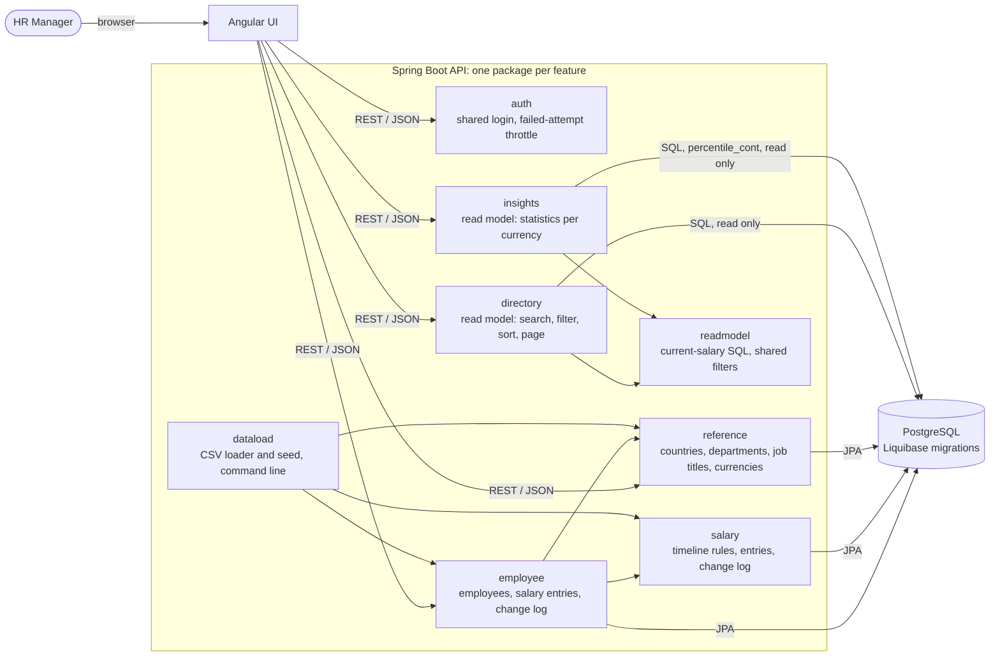
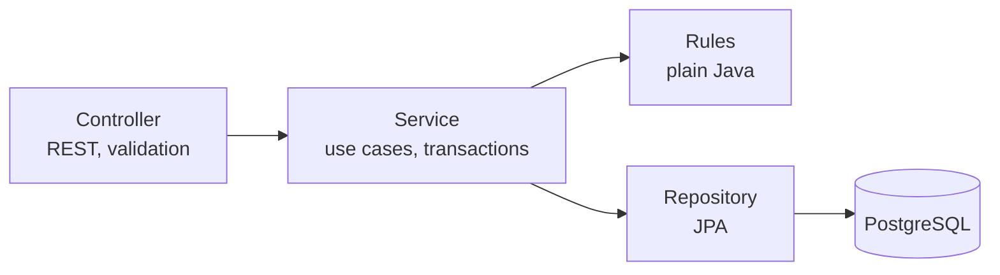
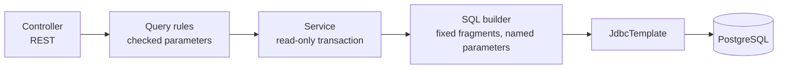
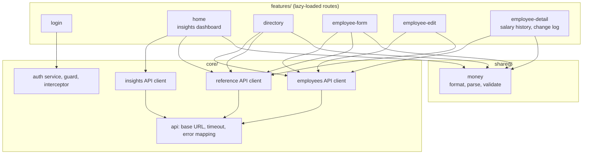
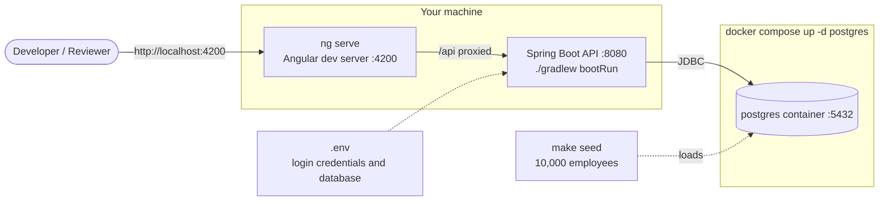

# Architecture

High-level view of ACME People Management as built. See [design.md](../design.md) for the reasoning behind each choice.

## 1. System overview

The Angular UI is a separate app from the API. The API is a Spring Boot modular monolith, one package per feature, that talks to PostgreSQL. There are no microservices.

- Every write to a salary entry goes through the `salary` feature, which is the only writer of salary rows. It checks the whole resulting timeline and writes the change log in the same transaction.
- `directory` and `insights` are read models. They join other features' tables in SQL, never write, and import no other feature's classes, only `readmodel`. This is the one exception to the rule that features reach each other through public services.
- Insights are computed in the database, always per currency. Currencies are never mixed or converted.
- The login is HTTP Basic from the environment. Every endpoint except health needs it.

## 2. Layers inside a feature

Each backend feature follows the same light layering, with a sub-folder per role: `api/` (controller and DTOs), `rules/` (plain classes) and `errors/`. The rules have no Spring or database dependencies, so unit tests run in milliseconds. One exception handler turns each exception type into a `problem+json` answer.

A read model has no repository. Its SQL is built from fixed fragments and every request value is a bound parameter.

## 3. Frontend structure

Standalone components with signals and Angular Material. The address holds the state of the dashboard and the directory.

Features do not import each other. `core/` and `shared/` never import from `features/`. The route guard keeps every page except the login behind the shared login, and the interceptor adds the login header to every API call. The login is kept in memory, so a page reload signs the user out.

## 4. Local deployment

Only PostgreSQL runs in a container. The API and the dev server run from the repository, as the README describes. The dev server forwards `/api` to the API, so the browser uses one origin and no CORS is needed. Credentials come from environment variables and are never hardcoded. The seed (10,000 employees, deterministic) is loaded once with `make seed`. Containers for the API and the web app, and a hosted deployment, are not built. See [design.md](../design.md#deployment).
