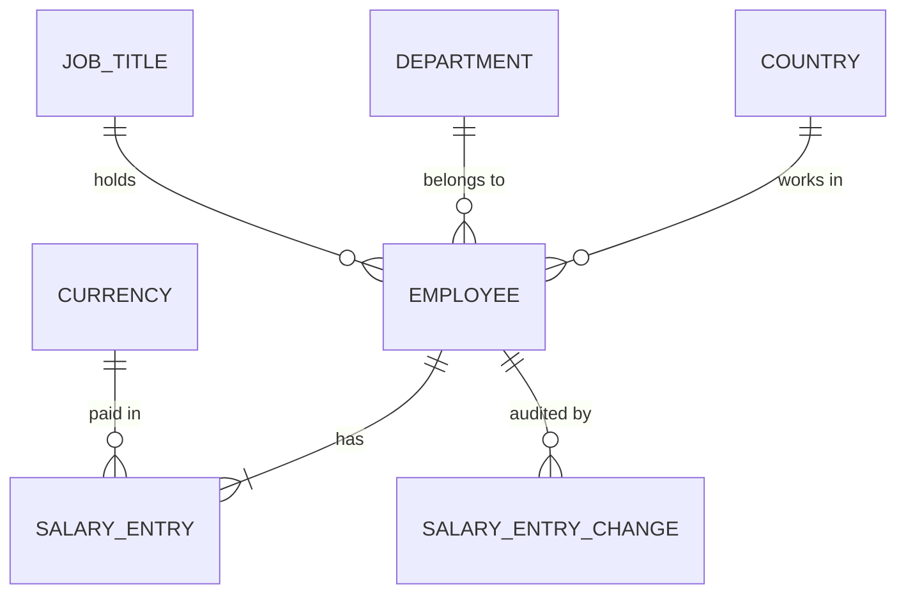

# ACME People Management: Design

Status: Draft. Architecture decisions, the data model and the API are written. Remaining sections are listed at the end.

## Decisions so far

| Decision | Choice | Why |
|---|---|---|
| Frontend framework | Modern Angular (not AngularJS) | AngularJS is end-of-life |
| Backend | Spring Boot, Java | Required by the brief |
| Build tool | Gradle | Project preference |
| Database | PostgreSQL 17 (see [ADR 0001](architecture/adr/0001-database.md)). The compose file and the tests use the same major version. | `percentile_cont` for medians, real-engine tests |
| Migrations | Liquibase | Project preference |
| UI component library | Angular Material | Official, accessible, table with server-side sort and pagination |
| Repo structure | Monorepo | See below |
| Backend structure | Package-by-feature with light layers | See below |
| Frontend structure | Feature folders with standalone components | See below |

## Testing approach

- **Unit tests:** JUnit and Mockito. No database or Docker. They cover salary history rules, validation, and service logic, and run in milliseconds.
- **Database integration tests:** PostgreSQL with Testcontainers, tagged `integration`, run by `./gradlew integrationTest` and in pre-push, never in pre-commit. They verify migrations, constraints, queries, and percentile calculations. They also verify that deleting an employee removes their salary entries and change rows and leaves other employees untouched, that deleting a single salary entry keeps its change rows, and that a salary change and its change-log row succeed or fail together.

## Architecture decisions and alternatives

### 1. Repo structure: monorepo

The repo layout is in the root [CLAUDE.md](../CLAUDE.md#repository-layout).

The frontend is a separate app from the API. Locally, a small nginx container serves the built Angular files and forwards `/api` to Spring Boot, so the browser sees one origin and no CORS setup is needed. During development, `ng serve` proxies `/api` to the API.

| Option | Pros | Cons |
|---|---|---|
| **Monorepo (chosen)** | One commit history. One clone and one README. API and UI change together in one commit. | Gradle and npm toolchains mix. |
| Two repos | Independent release cycles. | Split history. Two deploys and CORS to configure. No benefit for one developer and one team. |
| Monorepo with tooling (Nx, Turborepo) | Caching, affected-only builds. | Overbuilding for two modules. |

**Migration later:** easy. `git subtree split` on `backend/` or `frontend/` produces a separate repo with history. Splitting a monorepo is cheaper than merging two repos.

### 2. Backend structure: package-by-feature

The package rules are in [backend/CLAUDE.md](../backend/CLAUDE.md#structure).

Each feature keeps `controller → service → repository`. The salary history rules sit in plain classes with no Spring or database dependencies, so unit tests stay fast.

| Option | Pros | Cons |
|---|---|---|
| **Package-by-feature (chosen)** | Code that changes together lives together. Boundaries are visible, so extracting a module later is easy. | Needs discipline so features do not reach into each other's internals. |
| Package-by-layer | Familiar from tutorials. | One feature is spread over several folders. Hides boundaries. |
| Hexagonal / clean / DDD | Strongest isolation of domain logic. | Many extra interfaces and mappers. Heavy for CRUD plus analytics, and we are not swapping infrastructure. |
| Spring Modulith | Verifies module boundaries in tests. | Extra dependency, more than needed. |

**Migration later:** easy in either direction, mostly moving files. Moving toward hexagonal is gradual, and the framework-free salary rules are already close to a domain core.

### 3. Frontend structure: feature folders with standalone components

The folder rules are in [frontend/CLAUDE.md](../frontend/CLAUDE.md#structure).

Standalone components, lazy-loaded routes, and signals for state. No NgRx: plain services over the API are enough.

| Option | Pros | Cons |
|---|---|---|
| **Feature folders with standalone components (chosen)** | Current Angular default. Less boilerplate. Lazy routes by feature. | None significant. |
| NgModules | Older, widely documented. | More boilerplate. Treated as legacy by new Angular versions. |
| Package-by-type (`components/`, `services/`) | Simple at first. | Same scaling problem as package-by-layer. |
| NgRx or micro-frontends | Strict state management, or independent UI teams. | Heavy for about three screens. Micro-frontends solve a team problem we do not have. |

**Migration later:** easy. Standalone components mix with NgModules, and signals-based services can move into NgRx if state grows complicated.

### 4. Why a monolith, not microservices or a complex pattern

- **Scale:** 10,000 rows and one HR user do not need distributed services.
- **Cost:** microservices add network calls, service-to-service auth, per-service deployment, distributed transactions, and eventual consistency.
- **Salary history:** it needs a transaction and a database constraint. Splitting it from employee data would make that consistency hard.
- **Insights:** they are SQL joins and group-bys. These are cheap in one database and expensive across services.
- **Deployment:** the API is one deployable. The UI is static files served by nginx, so nothing else needs to run.
- **Pragmatism:** the simplest design that fits, with the reasoning recorded, is the goal.

**If scale arrives:** a modular monolith with feature packages is the stepping stone. If insights get heavy, the first step is a read-only replica or a reporting module, not a separate service. Extracting a feature package such as `insights` later means moving the package, adding an API boundary, and splitting its tables. That is bounded work, and far easier than merging microservices back together.

### 5. UI component library: Angular Material

A component library is a set of ready-made UI parts (tables, forms, dropdowns, date pickers, dialogs) that also handle keyboard support, accessibility, and a consistent look.

**Why:** the directory needs a sortable, paginated table over 10,000 employees, and the app needs several validated forms. Building these by hand would be overbuilding.

**Why Angular Material:** it is the official Angular library, covers every component we need, and provides accessible building blocks. Labels, validation feedback, focus and keyboard behaviour in our own screens still have to be built and checked.

| Screen | Angular Material provides | Stays in our code |
|---|---|---|
| Directory | Table, sort, paginator | Sending sort and page to the API |
| Employee form | Fields, select, date picker | Validation rules |
| Salary change | Dialog, date picker | Effective date rule |
| Insights | Tabs, table | Per-currency figures |

It does not call the API, format salaries, or draw charts.

See [architecture/architecture.md](architecture/architecture.md) for the architecture diagrams.

## Domain decisions

Settled while designing the data model and API. Each was debated against alternatives.

| # | Decision | Why |
|---|---|---|
| 1 | Currency belongs to each **salary entry**, not the employee. A `currency` table holds the ISO code and its minor-unit digits. | An employee can relocate and be paid in a new currency. Editing a currency on the employee would silently re-label old amounts. Minor units differ by currency (JPY 0, USD 2, KWD 3). |
| 2 | Employee ID is a database-generated `BIGINT`, used in URLs. | Smallest index, readable, stable. No external exposure to protect against. |
| 3 | The first salary entry is on or after the hire date and no later than today. | History starts when it is known. A salary cannot predate the hire. Everyone always has a current salary. |
| 4 | Money travels as integer minor units plus a currency code. | One representation from database to API. The backend never converts or rounds. |
| 5 | **Delete** removes a record entered by mistake, with its history. An employee who left gets a **termination date** and stays in the data. | "Entered by mistake" and "left the company" are different events. |
| 6 | Future-dated salary entries are allowed. **Current salary** is the latest entry dated on or before `asOf`. | HR enters raises in advance. No scheduler: "current" is computed at query time. |
| 7 | Any entry can be added, edited or deleted, as long as the **resulting timeline** is valid. | A typo must be fixable. Checking the final timeline replaces separate rules per operation. |
| 8 | Every add, edit and delete of a salary entry is written to a change table by the salary service, in the same transaction. | HR can see what changed and when. There is one shared login, so there is no "who". |
| 9 | No salary entry is dated after the termination date. | A leaver's last entry means what they were paid when they left. |
| 10 | The termination date is the **last employed day**. An employee is active on that date and former after it. | One meaning, used by the directory, the status filter and the insights. It also matches rule 9, which allows an entry dated on the termination date. |
| 11 | Migration from Excel is a one-time **CSV load from the command line**, through the same validation as typed data. The seed is the same loader fed by a generator. | HR will not retype 10,000 employees, but an upload screen is a feature of its own. Excel saves as CSV, so no spreadsheet parsing is needed. |
| 12 | Features read each other's data through public lookups and services, never through entities or repositories. `employee` stores plain keys for the department, job title and country, and `reference` exposes a public `ReferenceLookup`. `salary` stores a plain `employeeId`. This is for **writes and the domain**. Read models are the exception (decision 20). | Keeps entities and repositories private to their package, so no feature can change another's rows or depend on how they are stored. The foreign keys still protect the data. |
| 13 | A salary entry's end date is the **last day of its period**, the day before the next entry starts, and empty for the newest. `current` is the latest entry on or before today and `scheduled` is any entry after today, all worked out on the server from the injected clock. | One definition, matching the termination date meaning "last employed day". The browser's clock never decides which entry is current. |
| 14 | A second salary entry on an existing date is refused by the timeline validator under the employee row lock, with the unique index as a backstop. | The lock admits one writer at a time, so the check cannot be raced (shown by a test that races two adds 25 times, and over real HTTP). Every timeline invariant stays in one class. |
| 15 | A salary entry added without a currency takes the currency of the entry immediately before its date. If there is none, the currency is required. The date rules are checked first, so a date that cannot be used is reported as that and not as a missing currency. | The default follows the timeline, and gives a sensible answer for a backdated entry. Found by an end-to-end test: a duplicate of the first entry's date, sent without a currency, was reported as a missing currency. |
| 16 | The loader and the seed generator are two command-line modes of the existing jar (`--acme.load=<file>`, `--acme.seed-csv=<file>`), and `make seed` runs both. Each CSV row is created through `EmployeeService.create`, one transaction per row. | Imported rows obey exactly the same rules as typed ones, with one jar to build and no second write path to salary rows. A raw SQL load would be faster but would skip the rules. |
| 17 | The seed's pay is a small multiplicative model: a base per job title, times a factor per country, times a tenure uplift (4% a year, capped at 10 years), times seeded noise of up to 10%. It is paid in the country's own currency. Each salary is dated at the employee's most recent work anniversary. | Insights by country, title and tenure find real differences, from a few constants in one class. The date agrees with the tenure uplift. The constants are synthetic, and the product never converts currency. |
| 18 | The generator keeps its own table of titles, departments and countries, and an integration test checks it against the reference data in both directions. | The table needs pay figures by title anyway, so reading the reference lists would not remove it. The test makes a reference change fail loudly instead of in a load. |
| 19 | Leavers are not loaded until slice 6. The CSV keeps the `terminationDate` column, and the loader rejects a non-empty value with "Termination dates are not supported yet." The generator writes none. | The create path has no termination date, and its two rules arrive with the edit endpoint. Slice 4 adds no rule that nothing in the UI can reach. **Superseded by decision 29 in slice 6.** |
| 24 | **Terminating is setting `terminationDate`** in the profile edit. There is no separate terminate endpoint, and clearing the date makes the person active again. | The design lists `PUT` as editing the profile "including `terminationDate`". A second endpoint would repeat the same checks. |
| 25 | `PUT /api/employees/{id}` **replaces the profile** and carries the `version`. The service reads the employee under the row lock, compares the version, and answers `409 VERSION_CONFLICT` on a mismatch. A successful update bumps the version, and adding a salary entry does not. | One request at a time per employee, so the comparison cannot be raced. Hibernate's `@Version` check alone would fire at flush, after the rules had run on stale data. A partial `PATCH` was rejected because "absent" and "empty" would need different meanings for the nullable termination date. |
| 26 | The salary timeline is **revalidated on every update, before anything is written**, with an `EmploymentPeriod(hireDate, terminationDate)`. The order is termination before hire, entry before hire, duplicate date, no current salary, entry after termination. An entry dated on the termination date is allowed, and a termination date in the future is allowed. Adding a salary entry checks the termination date too. | The rules read both dates. Running them before the write means a broken rule is a `422` with its code, and not the database's own `termination_date >= hire_date` check surfacing as a `500`. |
| 27 | `DELETE /api/employees/{id}?version=N` removes the employee and, through the cascade, their salary entries, and answers `204`. A missing version is a `400`. The screen asks for confirmation, naming the person. | The design requires the version on delete. A request body on `DELETE` is unreliable across proxies. |
| 28 | The edit form is its own feature (`/employees/:id/edit`) with no salary fields. A stale version shows a banner with "Reload", which loads the latest values and discards the edits. | The create form is built around the first salary. Merging a stale edit automatically would hide someone else's change. |
| 29 | **Leavers are loaded and seeded.** The loader reads `terminationDate`, and about 8% of the seed are leavers who left on or after their hire date and before today, with a salary dated at their last work anniversary on or before they left. | This is what decisions 10 and 19 prepared. The seed's leavers are loaded in a test, so one that broke a rule would be rejected there. |
| 30 | Editing or deleting a salary entry takes the employee row lock, builds the **resulting timeline** and runs the same validator as adding one, with the employee's employment period. Deleting the last entry is refused (`NO_CURRENT_SALARY`). | One validator covers add, edit and delete, so a termination date, a hire date and every entry stay consistent. |
| 31 | The change row is written **in the same transaction** as the salary change, by the salary service, which is the only writer of salary rows. Adding an entry logs `ADDED`. Creating an employee and the CSV load log nothing, because an initial load is not a change. | A change and its row succeed or fail together. A refused change leaves no row. |
| 32 | An edit that changes nothing writes **no change row**, and an omitted currency keeps the entry's own. | A no-op logged as a change is noise, and an edit has no "entry before the date" to default from. |
| 33 | `salary_entry_change.entry_id` is not a foreign key, so deleting an entry keeps its change rows, and the row's shape is checked in the database: `ADDED` has only new values, `DELETED` only old ones, `EDITED` both. The employee page shows the log newest first, with times in UTC. | As in the data model. What a constraint can express goes in the database. |
| 34 | `insights` is a **read model** like the directory: native SQL on `JdbcTemplate`, no writes, no other feature's classes. The current-salary join, the "active" condition, the status filter and the shared filters (country, department, job title, currency, status) live once in a `readmodel` package that both read models use. | Each decision lives in one place. A third copy of "active" is how two screens come to disagree. |
| 35 | **One generic query serves every dimension.** Each dimension owns fixed SQL for its group key, label and order, and every request value is a bound parameter. A hostile value is tested to stay out of the SQL. | One mechanism is less code than six queries, and the client never supplies SQL. |
| 36 | The statistics are computed in the database. `total` is an exact `numeric` sum and is sent as a **decimal string**. `min` and `max` are exact numbers. `mean` is `round(avg(...))` and `median` is `round(percentile_cont(0.5) ...)`, both rounding half up to whole minor units. | A sum of many amounts can pass 2^53 and would lose digits in the browser. Rounding is stated, not left to the database default. |
| 37 | `percentile_cont` works in double precision, so the **median is exact up to 2^52** and can be one minor unit low above that. A test pins the behavior at the cap. | Measured on PostgreSQL 17. No realistic salary is near that size, and an exact median by row position was rejected as a departure from the design for a case that cannot occur. |
| 38 | Tenure is **completed years** from the hire date to the earlier of today and the termination date. The bands are under 1 year, 1 to under 3, 3 to under 5, 5 to under 10, and 10 or more. | As the requirements say. A hire date exactly one year ago is in the 1 to 3 band and one day later is under 1. |
| 39 | An `OVERALL` dimension (everyone in one group per currency) is the sixth, for the requirements' "How many people do we pay, and what is the total payroll?". Extremes take the same filters as the insights and need a currency, a limit of 1 to 50 (default 10), and break ties by employee id. | The requirements list an overall view. Ranking across currencies is meaningless. |
| 40 | The dashboard is the **home page** and keeps its state in the URL. The ranking currency is the one chosen, else the currency filter, else the first group's currency, and it is not asked for while the groups reload. Figures are not drawn until the currency list is loaded. | Back from an employee returns to the same view. A ranking in the previous currency, and a flash of raw amounts, were found in the first real run. |
| 20 | The directory is a **read-side package** (`directory`) that joins `employee`, `salary_entry` and the reference tables in SQL on `JdbcTemplate`. Writes still go only through the owning service. Read models (the directory, then the insights) may join across tables and never write. This amends decision 12. | The directory must filter by the currency of the current salary and sort by salary over 10,000 rows, with the page cut in the database. Asking each feature row by row cannot do that, and a copy of the current salary on `employee` would go stale when a future-dated raise takes effect. |
| 21 | The current salary is a **lateral join**: the latest `salary_entry` on or before `asOf`, per employee. | Measured on 10,014 employees against a window function: 7.2 ms against 6.1 ms (filter and salary sort) and 9.2 ms against 8.3 ms (default view), which is noise at this size. The lateral form costs one index probe per employee and reads like the rule. |
| 22 | Directory search is a case-insensitive **contains** on name or email, with `%`, `_` and `\` escaped. Blank means no search, and over 100 characters is a `400`. There is no index. | Measured at about 5.5 ms for any search on 10,014 rows. The escaping is for correctness: underscores are common in emails, and a typed `%` would match every row. |
| 23 | The directory lives at `/employees` and keeps its **filters, sort, page and search in the URL**. The home page links to it and becomes the insights dashboard in slice 8. | Back and Forward move through views and a link can be shared. The product doc makes the insights the core and the directory the supporting layer. |

## Data model



| Table | Columns | Constraints and indexes |
|---|---|---|
| `currency` | `code` (ISO 4217), `minor_unit_digits` | PK `code`. Check `code` is three capital letters. Check `minor_unit_digits >= 0`. |
| `country` | `code` (ISO 3166 alpha-2), `name` | PK `code`. Check `code` is two capital letters. Check `name` is not blank. |
| `department` | `id`, `name` | PK `id`. Unique on `lower(name)`, so a name differing only in case is a duplicate. Check `name` is not blank. |
| `job_title` | `id`, `name` | PK `id`. Unique on `lower(name)`. Check `name` is not blank. No levels or grades. |
| `employee` | `id` (`BIGINT` identity), `full_name`, `email`, `hire_date`, `termination_date` (nullable), `department_id`, `job_title_id`, `country_code`, `version` | PK `id`. FKs to the three reference tables. Unique on `lower(email)`. Check `termination_date >= hire_date`. Indexes on `country_code`, `department_id`, `job_title_id`. `version` is the optimistic-lock column. |
| `salary_entry` | `id` (identity), `employee_id`, `effective_date`, `amount_minor` (`BIGINT`), `currency_code` | PK `id`. FK `employee_id` `ON DELETE CASCADE`. FK `currency_code`. Unique `(employee_id, effective_date)`. Check `amount_minor BETWEEN 1 AND 9007199254740991`. The upper bound is the largest integer that a `double precision` and a JavaScript number both hold exactly, so a single amount is exact in both. Sums can exceed it, see the numeric contract under Insights. **No end-date column**: it is derived from the next entry. |
| `salary_entry_change` | `id`, `employee_id`, `entry_id`, `action` (`ADDED`, `EDITED`, `DELETED`), `old_effective_date`, `old_amount_minor`, `old_currency_code`, `new_effective_date`, `new_amount_minor`, `new_currency_code`, `changed_at` (`TIMESTAMPTZ`) | PK `id`. FK `employee_id` `ON DELETE CASCADE`. `entry_id` is deliberately not a FK: the entry may be gone. Index `(employee_id, changed_at DESC)`. |

### Scope notes

- Departments and job titles are one global list. They are not specific to a country.
- The change log covers salary entries only. Profile changes and terminations are not audited.

### What the database enforces and what the service enforces

The database enforces what a constraint can express: keys, foreign keys, not-null, unique email, one entry per employee per date, the amount range, `termination_date >= hire_date`, and the delete cascade.

The rules that span several rows cannot be expressed as constraints without a trigger. We keep triggers out and put them in one pure domain class (no Spring, no database). For every change that can affect an employee's salary timeline, the service builds the **resulting timeline** and validates these invariants on it:

| Invariant | Error code |
|---|---|
| Effective dates are unique per employee | `DUPLICATE_SALARY_DATE` |
| The earliest entry is on or after the hire date | `SALARY_BEFORE_HIRE_DATE` |
| At least one entry is effective on or before today, so there is always a current salary (this also rejects an empty timeline) | `NO_CURRENT_SALARY` |
| The latest entry is on or before the termination date, if there is one | `SALARY_AFTER_TERMINATION` |
| The termination date is on or after the hire date | `TERMINATION_BEFORE_HIRE_DATE` |

The same validator covers adding, editing and deleting an entry, and editing the hire or termination date. Nothing needs a separate rule for each operation.

**Locking.** Two requests could both validate against the old state. So every operation that can affect these invariants takes the same row lock on the employee, re-reads the committed state under that lock, then validates and writes. That includes salary add, edit and delete, hire and termination date edits, and employee delete. `PUT /api/employees/{id}` always checks the optimistic `version`, and takes the lock and revalidates the timeline whenever `hireDate` or `terminationDate` change. The version increments on every successful profile update. The two mechanisms solve different problems and coexist. Salary operations take the lock but do not bump `version`, so a salary change does not invalidate an open employee edit form. That is safe because the profile fields are independent of the salary amounts, and a stale form that changes a date is revalidated against the current timeline under the lock. A test submits a stale profile form after a concurrent salary change and asserts the final state. Integration tests fire conflicting requests concurrently and assert the **final database state**, not only the responses. For example, a raise is added while the employee is terminated before it, and the second request must fail.

### Deleting an employee

Deleting removes the employee, their salary entries and their change-log rows in one statement (`ON DELETE CASCADE`). This is deliberate. Delete is for records entered by mistake. An employee who left is terminated and keeps their history. Deleting a single salary entry keeps its change rows, because `entry_id` is not a foreign key.

We chose this because it is the simplest option and leaves nothing retained or mis-handled after a delete. It does not by itself satisfy any legal erasure or retention requirement: backups and logs are outside it, and some jurisdictions require salary records to be kept for a period.

Safeguards against deleting the wrong employee:

- `DELETE /api/employees/{id}` requires the employee's `version`, like `PUT`. A delete based on a stale view fails with 409 `VERSION_CONFLICT`.
- The UI asks for confirmation. That only prevents a mis-click and is not a control.
- The real protection is database backups, which a local deployment does not have.

The cost, the residual risk and the upgrade path are in [tradeoffs.md](tradeoffs.md).

### Shared query definitions

Written once and reused by the directory and the insights:

- **Active employee:** `termination_date` is null or on or after `asOf`.
- **Current salary:** the latest entry dated on or before `asOf`.

`asOf` is today in the business timezone, taken from an injected `Clock`. The timezone is set through an environment variable and defaults to UTC. Timestamps are always stored in UTC. SQL receives it as a parameter, so queries stay deterministic. A database view cannot take a parameter, so the current salary is a lateral join written as one SQL fragment (decision 21), which the insights reuse.

### Migration order

One Liquibase changeset per slice, never one big migration:

1. Slice 1: `currency`, `country`, `department`, `job_title`, with their reference rows.
2. Slice 2: `employee`, `salary_entry`.
3. Salary editing slice (slice 7): `salary_entry_change`.

The seed and the CSV loader are the same code (see Data loading). Rows go through the pure timeline validator and the reference lookups, then are written without change-log rows, because an initial load is not a change.

## API

REST and JSON under `/api`. Fields are camelCase. Dates are `YYYY-MM-DD`. Every `/api` call needs the shared login. `/actuator/health` is open.

### Conventions

| Topic | Convention |
|---|---|
| Auth | HTTP Basic with the shared credentials from environment config. Every `/api` endpoint is authenticated by default, and the browser reaches the API through the same origin. As defense in depth, the 401 response carries **no `WWW-Authenticate` challenge**, so the browser never shows its login prompt or caches credentials, and a test asserts the header is absent. That is not the main control: browser behaviour varies, so a hosted deployment must use HTTPS. One shared account cannot attribute a change to a person. A throttle blocks a client after 5 failed attempts within 60 seconds, answering 429 with `Retry-After`. See [tradeoffs.md](tradeoffs.md). The frontend keeps the credentials in memory only, so a page refresh means logging in again, and sends them on every call. `GET /api/auth/me` returns 200 for valid credentials and 401 otherwise. `/actuator/health` shows status only, no details. |
| Money | `{ "amountMinor": 125000000, "currency": "INR" }`. The frontend formats using `minorUnitDigits` from `GET /api/reference/currencies`. Insight totals are decimal strings (see Insights). |
| Errors | `application/problem+json` with `type`, `title`, `status`, `detail`. Validation failures add `errors: [{ field, message }]`. Business rules add a stable `code`. |
| Status codes | 400 invalid input. 401 no or bad login. 404 not found. 409 stale `version` or duplicate email. 422 business rule broken. 429 too many failed login attempts. |
| Pagination | `page` (from 0), `size` (default 20, max 100), `sort=field,asc|desc`. A stable `id` tie-breaker is always appended. The response is our own envelope: `{ content, page, size, totalElements, totalPages }`. |
| Concurrency | The employee resource carries `version`. Edits and deletes send it back. A mismatch is a 409 `VERSION_CONFLICT`. |

Business rule codes: `DUPLICATE_SALARY_DATE`, `SALARY_BEFORE_HIRE_DATE`, `NO_CURRENT_SALARY`, `SALARY_AFTER_TERMINATION`, `TERMINATION_BEFORE_HIRE_DATE`, `EMAIL_ALREADY_EXISTS`, `VERSION_CONFLICT`.

### Endpoints

| Method and path | Purpose | Slice |
|---|---|---|
| `GET /api/auth/me` | Check the login | 0 |
| `GET /api/reference/countries` | `[{ code, name }]` | 1 |
| `GET /api/reference/departments` | `[{ id, name }]` | 1 |
| `GET /api/reference/job-titles` | `[{ id, name }]` | 1 |
| `GET /api/reference/currencies` | `[{ code, minorUnitDigits }]` | 1 |
| `POST /api/employees` | Create an employee with the first salary entry | 2 |
| `GET /api/employees/{id}` | Employee detail with current salary and `version` | 2 |
| `GET /api/employees/{id}/salary-entries` | History, newest first, each with a derived `endDate` and `current` and `scheduled` flags | 3 |
| `POST /api/employees/{id}/salary-entries` | Add an entry. `currency` defaults to the preceding entry's. | 3 |
| `GET /api/employees` | Directory: search, filter, sort, paginate | 5 |
| `PUT /api/employees/{id}` | Edit the profile, including `terminationDate`. Needs `version`. | 6 |
| `DELETE /api/employees/{id}` | Delete a mistaken record and its history. Needs `version`. | 6 |
| `PUT /api/employees/{id}/salary-entries/{entryId}` | Edit an entry | 7 |
| `DELETE /api/employees/{id}/salary-entries/{entryId}` | Delete an entry | 7 |
| `GET /api/employees/{id}/salary-changes` | Change log, newest first | 7 |
| `GET /api/insights` | Statistics per slice and currency (sketch below) | 8 |
| `GET /api/insights/extremes` | Highest or lowest paid individuals (sketch below) | 8 |

### Slice plan

Each slice delivers a working increment: the API, then its Angular screen, then tests for both. They are committed separately as `feat(api)` and `feat(ui)`, so a reviewer can follow each half. Slice 1 has no screen, because the reference lists only appear inside forms. Every screen handles loading, empty, validation and error states.

| Slice | Backend | Frontend |
|---|---|---|
| 0 | Shared login, `GET /api/auth/me`, 401 without a challenge header, failed-attempt throttle | Login page, credentials in memory, request interceptor, auth guard |
| 1 | Persistence foundation and the four reference lists | None |
| 2 | Create employee with the first salary entry, employee detail | Create-employee form, employee detail page |
| 3 | Salary history list, add an entry | History table on the detail page, add-change dialog, current and scheduled markers |
| 4 | CSV loader and deterministic seed generator (no endpoint). It comes before the directory and the insights, so both are built and measured against realistic volume. | None |
| 5 | Directory: search, filter, sort, paginate. A read-side `directory` package (decisions 20 to 23). | Directory table at `/employees` with filters, status filter and currency-safe salary sort, its state in the URL |
| 6 | Edit employee, terminate, delete (both need `version`). The loader and the seed carry leavers. Decisions 24 to 29. | Edit form with a termination date, delete with confirmation |
| 7 | Edit and delete a salary entry, change log (migration 011), and the change-log write on adding an entry. Decisions 30 to 33. | Edit and Delete in the history table, a change history list |
| 8 | Insights and extremes (`readmodel` shared with the directory). Decisions 34 to 40. | Dashboard on the home page: dimension, filters, statistics per currency, highest and lowest paid |
| 9 | Wrap-up: README and the insight timings. | None |

The skill for the repeated backend pattern (endpoint plus database change) is written after slice 2, when a read and a write have both been built. A matching frontend skill follows once a few screens share a pattern.

### Shapes (first slices)

```
POST /api/employees
{ "fullName": "Asha Rao", "email": "asha.rao@acme.example", "hireDate": "2024-04-01",
  "departmentId": 3, "jobTitleId": 12, "countryCode": "IN",
  "initialSalary": { "effectiveDate": "2024-04-01", "amountMinor": 125000000, "currency": "INR" } }
```

`initialSalary.effectiveDate` is optional and defaults to the hire date. The response is `201` with a `Location` header and the employee detail:

```
{ "id": 10432, "fullName": "Asha Rao", "email": "asha.rao@acme.example",
  "hireDate": "2024-04-01", "terminationDate": null, "status": "ACTIVE",
  "department": { "id": 3, "name": "Engineering" },
  "jobTitle": { "id": 12, "name": "Software Engineer" },
  "country": { "code": "IN", "name": "India" },
  "currentSalary": { "effectiveDate": "2024-04-01", "amountMinor": 125000000, "currency": "INR" },
  "version": 0 }
```

### Directory filters and sort

`GET /api/employees` accepts `q` (name or email contains), `countryCode`, `departmentId`, `jobTitleId`, `currency` and `status` (`ACTIVE` default, `FORMER`, `ALL`). Sort fields: `fullName`, `department`, `jobTitle`, `country`, `hireDate`, `salary`.

The `currency` filter means the currency of the employee's **current salary**. **Sorting by `salary` requires a `currency` filter** and returns 400 without one. Comparing amounts across currencies would mix them.

Defaults are `status=ACTIVE`, `sort=fullName,asc`, `page=0` and `size=20` (1 to 100). Every sort appends `id` ascending, so pages never overlap. A sort field maps to a fixed SQL expression and every filter value is a bound parameter, so no client text reaches the SQL. A rule-breaking request is a `400` with `errors: [{ field, message }]`. An unknown `departmentId` or `countryCode` is not an error: it matches nothing and gives an empty page. Each row carries the department, job title and country names, the status, the hire date and the current salary. The spec is [slice 5](superpowers/specs/2026-10-24-slice-5-directory-design.md).

### Insights (sketch, built in slice 8 as decisions 34 to 40)

**Scope.** Insights cover **active employees by default**, using each employee's current salary as of today. The `status` filter can widen this to former employees or all. Historical snapshots, such as "who was employed on a past date", are out of scope. `asOf` is internal and is not a request parameter.

- `GET /api/insights?dimension=COUNTRY|DEPARTMENT|JOB_TITLE|TITLE_COUNTRY|TENURE` plus the same filters as the directory. Returns one group per slice value and currency: `headcount`, `total`, `min`, `median`, `mean`, `max`, computed in the database with `percentile_cont`.
- `GET /api/insights/extremes?order=HIGHEST|LOWEST&limit=N&currency=...` plus filters. A currency is required, for the same reason as sorting. Results are ordered by amount, then by employee ID, so ties are stable. At most `limit` employees are returned, even when that splits a tie. Each result includes its salary effective date.

**Numeric contract.** `total`, `min` and `max` are exact in minor units. `median` and `mean` can be fractional, so they are returned as integer minor units rounded half up, calculated after casting to `numeric`. A test pins this rule with an even-sized group, such as middle values 100 and 101.

A sum of many amounts can exceed the largest integer a JavaScript number holds exactly, even though each amount cannot. The database sum is exact (`sum` of a `bigint` returns `numeric`), but a JSON number would lose precision in the browser. So **`total` is returned as a decimal string**. `min`, `max`, `mean` and `median` stay numbers, because they are bounded by the per-entry cap. The median goes through `percentile_cont`, whose input types we have not verified against the PostgreSQL manual, so a test with values near the cap pins its behaviour.

**Headcount** counts the employees in that slice and currency only. Statistics from different currencies are never added together.

**Query safety.** The supported dimensions are a fixed set, and each maps to a fixed SQL expression. Filter values are bound parameters. The client never supplies a column name or any SQL fragment.

**Tenure bands.** Under 1 year, 1 to under 3, 3 to under 5, 5 to under 10, and 10 or more. Tenure runs from the hire date to the earlier of today and the termination date, in completed years, so every employee falls into exactly one band. Final bands are confirmed in the insights slice.

**Tests to write for the insights slice:** an empty group, a single employee, even and odd group sizes, several currencies, a future-dated entry, a former employee, an employee on exactly a tenure boundary, a tie in the extremes, and a total above the JavaScript-safe integer that round-trips unchanged through the API and the Angular parsing path.

## Data loading

One loader serves two purposes: migrating ACME's existing spreadsheet, and loading the 10,000-employee seed. The seed is a deterministic generator that writes a CSV in the loader's format. Both run from the command line as modes of the application jar, and `make seed` runs the two in turn (decision 16). There is no upload screen.

**CSV format.** One row per employee with their current salary:

`fullName, email, hireDate, department, jobTitle, countryCode, currency, salary, salaryEffectiveDate, terminationDate`

- `salaryEffectiveDate` is optional and defaults to the hire date. `terminationDate` is optional, so leavers can be migrated (decision 29).
- Dates are ISO (`2024-04-01`). Columns are found by header name, so their order does not matter. A missing, unknown or repeated header rejects the whole file before any row is read.
- `salary` is written in major units, as Excel holds it (`1250000.00`). The loader converts it using the currency's minor-unit digits and rejects an amount with more decimals than the currency allows.
- `department` and `jobTitle` match the reference names, ignoring case and surrounding spaces.

**Rules.** Each row goes through the pure timeline validator and the reference lookups, so imported data obeys the same rules as typed data. A row is rejected, not the whole file. A rejected row is reported with its row number (the header is row 1), field and reason, and the other rows still load. Only a row problem counts as a rejection: an unexpected failure, such as a database error, stops the run. The summary gives counts loaded and rejected, and the exit status is non-zero when anything was rejected.

**Re-running** the same file is duplicate-safe but not a no-op: every row already loaded is reported as `EMAIL_ALREADY_EXISTS`, nothing new is loaded, and the exit status is non-zero.

**Limits, stated up front.**

- **Titles and departments are a standardized list that HR cannot extend.** A spreadsheet with free-text titles will have rows rejected for unknown values. The report lists each rejected row with its field, so what to add to the list through a migration is visible, but it does not group them. See [tradeoffs.md](tradeoffs.md).
- Only the current salary is loaded. A second file for salary history can be added later.
- `.xlsx` is not parsed. HR saves the sheet as CSV.
- Throughput is measured: 10,000 rows load in about 33 seconds, one transaction per row, so writes are not batched. The numbers are in [tradeoffs.md](tradeoffs.md).

## Deployment

**Current decision:** run locally for now and record the demo video from the local run. Hosted deployment is deferred.

- Today `docker compose up` starts PostgreSQL only. The API and `web` containers (nginx serving the Angular build and proxying `/api` to the API) and the seed on first start are planned and not built. Run the API and the dev server by hand, as the README describes.
- For development, run the API and `ng serve` with a proxy to `/api`.
- The shared login credentials come from environment variables.
- The README lists the run, test and seed commands.

**Open risk:** the brief lists deployed software as a requirement. If it must be hosted, the same Docker images can go to a free host (Render with Neon Postgres was the leading option) as a final step. 
